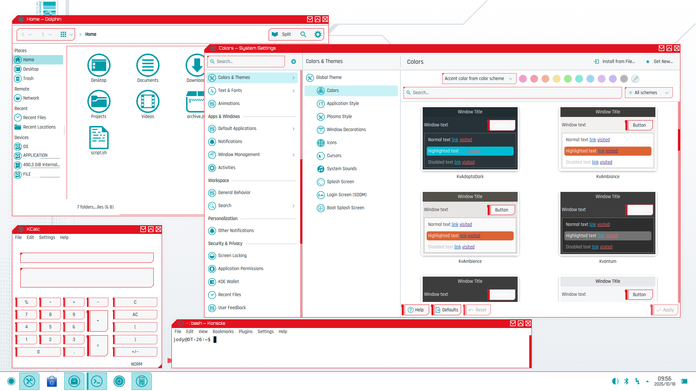
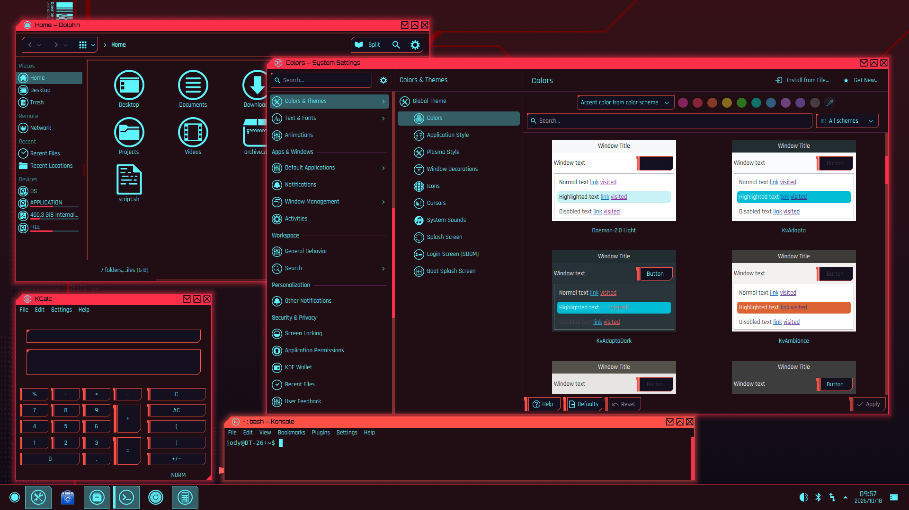
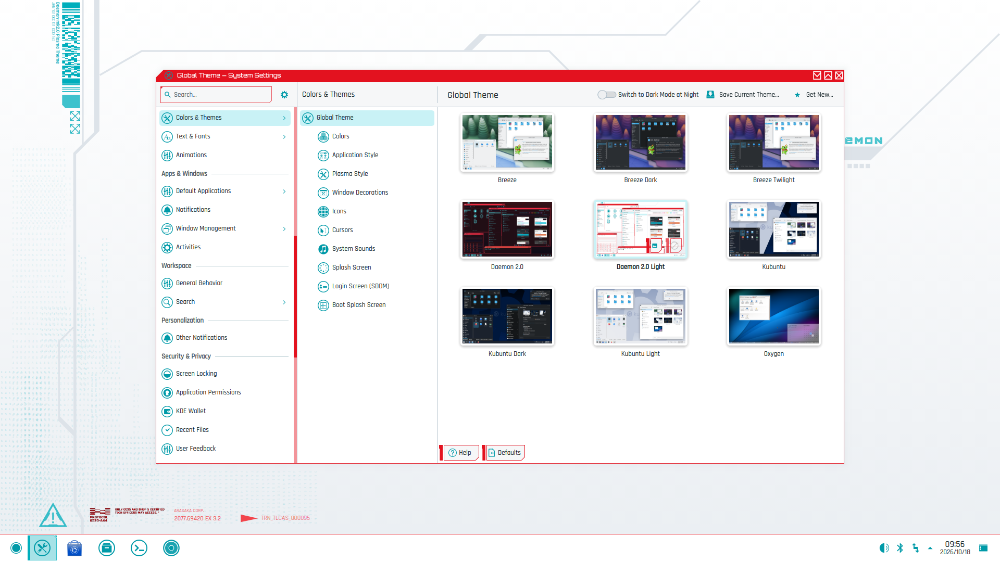

# DaemonKDE: Daemon 2.0, dark and light, for Kubuntu

The cyberpunk [Daemon 2.0](https://github.com/MathisP75/daemon-kde-mk2) theme by Mathis Paquet for
KDE Plasma 6, with a new **light variant**. One command installs both as global themes, so they
appear in System Settings and work with Plasma's "Switch to Dark Mode at Night", and everything can
be undone. Made for Kubuntu (tested on 26.04, Plasma 6.6, Wayland); any Plasma 6 system should work
(day/night switching needs Plasma 6.5 or newer).

| Daemon 2.0 Light | Daemon 2.0 |
|---|---|
|  |  |



## Why a light variant

With astigmatism, light text on a black background blurs and haloes. Daemon 2.0 Light keeps the
theme's identity (red frames, angular shapes, cyan accents, Rajdhani and Orbitron fonts) but puts it
on pure white. It uses three color families, each in graded steps (`light/palette.py`):

- **white and neutral greys**: `#ffffff` windows and views, greys from `#f6f7f8` to `#7a838c` with no
  pink or yellow cast, and near-black text (`#0e1d22`, about 17:1 on white);
- **true red** (`#e3121f` frames and title bars, `#c40f1a` as text). Red is only ever used
  saturated, because pale red reads as pink; pale fills are grey or cyan;
- **bright cyan**, from the pale selection tint `#c9f2f6` through `#00aebc` lines and `#009aa8` icons
  to `#007c87` where cyan is text;
- the wallpaper becomes white with cool-grey circuit lines and cyan dot grids. It is one wallpaper
  package with light and dark images, and Plasma picks the right one from the color scheme on its own.

The light variant is generated from the dark one (`light/build.py` + `light/palette.py`), so the two
stay in step: every part of the theme has a light twin.

## Install

```bash
sudo apt install qt-style-kvantum git
git clone https://github.com/jody0731/DaemonKDE.git ~/Projects/BrainStorm/DaemonKDE
bash ~/Projects/BrainStorm/DaemonKDE/install.sh
```

Both themes are always installed, **Daemon 2.0 Light** is applied, and both are set as Plasma's
light/dark pair for day/night switching. Log out and in once afterwards: that is when the Orbitron
window titles appear and open apps pick up the new widget style.

No sudo in the scripts: everything goes to `~/.local/share` and `~/.config`. Every file added and
every setting changed (with its old value) is recorded in `backup/<timestamp>/state.txt`, and a
failure half-way rolls everything back.

| Option | Effect |
|---|---|
| `--dark` | start with Daemon 2.0 (dark) instead of Light |
| `--auto` | turn day/night switching on right away |
| `--reinstall` | already installed? uninstall, then install again; keeps your variant and day/night setting |
| `--files-only` | copy the themes, change no settings (pick them yourself in System Settings) |
| `--keep-fonts` | leave your UI fonts alone |
| `--keep-wallpaper` | leave your wallpaper alone |
| `--no-kvantum` | skip the Kvantum widget style |
| `--keep-vscode` | don't install or select the VS Code theme (done only if `code` is installed) |

## Switch between light and dark

Any of these:

- **System Settings > Colors & Themes > Global Theme**: pick *Daemon 2.0* or *Daemon 2.0 Light*.
- **Day/night**: the *Switch to Dark Mode at Night* toggle on that page (or `switch.sh auto`) uses
  Daemon 2.0 Light by day and Daemon 2.0 at night. The times come from System Settings > Night Light
  (sunrise/sunset for your location, or fixed times).
- **Terminal**: `bash ~/Projects/BrainStorm/DaemonKDE/switch.sh light | dark | toggle | auto | status`
  (`light`, `dark` and `toggle` turn day/night switching off).
- **App launcher / KRunner**: search *Daemon 2.0* or *Daemon 2.0 Light*.

Colors, icons, the panel, window frames and the wallpaper change at once. Konsole (default profile
and every open tab) and VS Code follow too, however the switch happened: a small watcher
(`switch.sh --follow`, started from `~/.config/autostart`) keeps them in step with the global theme,
and VS Code follows the system's light/dark preference itself. Already-open applications keep their
old Kvantum widgets until they are restarted (or you log out and in).

## Update an existing install

```bash
cd ~/Projects/BrainStorm/DaemonKDE && git pull
bash install.sh --reinstall
```

## Uninstall

```bash
bash ~/Projects/BrainStorm/DaemonKDE/uninstall.sh
```

Settings are put back one by one from the record, not by copying old config files over, so anything
else you changed since is left alone. The one exception is `~/.config/kdedefaults`, Plasma's
defaults layer that global themes write to: it is restored from the copy taken at install.

## What it sets

| Part | Dark | Light |
|---|---|---|
| Global theme | `Daemon 2.0` (`org.daemonkde.dark.desktop`) | `Daemon 2.0 Light` (`org.daemonkde.light.desktop`) |
| Color scheme | `Daemon2` | `Daemon2Light` |
| Plasma style | `Daemon-2.0` | `Daemon-2.0-Light` |
| Window decoration (Aurorae) | `daemon-2.0` | `daemon-2.0-light` |
| Widget style | `kvantum-dark` (Kvantum `DaemonDark`) | `kvantum` (Kvantum `Daemon`) |
| Icons | `Daemon-Icons` | `Daemon-Icons-Light` |
| Konsole profile (default) | `Daemon` | `Daemon Light` |
| VS Code color theme | `Daemon-2.0` | `Daemon-2.0 Light` |
| Wallpaper | `Daemon 2.0` (its dark images) | `Daemon 2.0` (its light images) |
| Fonts (both) | Rajdhani Medium 10 (UI), Hack 10 (fixed), Orbitron 8 (window titles) | |

The global themes have no layout script, so applying one never touches your panels or widgets. They
also leave the cursor, splash screen and wallpaper alone (the wallpaper package switches itself).
Kvantum's theme setting stays `Daemon`: the `kvantum` style draws `Daemon`, `kvantum-dark` draws
`DaemonDark`, so a global theme can switch Kvantum by switching the widget style.

VS Code also gets `window.autoDetectColorScheme` with the two themes as preferred light/dark themes,
and `window.titleBarStyle: native`, so KDE draws its frame like every other window.

## Layout

| Path | What |
|---|---|
| `install.sh`, `switch.sh`, `uninstall.sh` | the three commands; `lib/variants.sh` holds what each variant is made of |
| `global-themes/` | the two look-and-feel packages (generated by `light/build.py`, previews from `preview/gallery/`) |
| `upstream/` | the parts of the original theme that get installed, from a pinned commit (`upstream/SOURCE.md`) |
| `light/` | the light variant: `palette.py` (the colors), `build.py` (generator) and its committed output |
| `vscode/` | `build.py` builds `daemon-2-0.vsix` with both themes, from `overrides.jsonc` and `overrides-light.jsonc` |
| `konsole/` | the two Konsole profiles |
| `fonts/` | Rajdhani and Orbitron (SIL OFL), vendored so install needs no network |
| `wallpaper/Daemon-2.0/` | the wallpaper package: `images/` light, `images_dark/` dark, at 1920×1080, 2560×1440 and 3840×2160 |
| `preview/verify.sh` | the regression suite: runs the real scripts in a throwaway nested Plasma session and refreshes `preview/gallery/` |

### Tuning the light theme

Edit `light/palette.py` (or the hand-written parts of `light/build.py`), then:

```bash
python3 light/build.py --wallpaper     # --wallpaper re-renders the PNGs with headless Chrome
python3 vscode/build.py
bash preview/verify.sh                 # about 8 minutes; never touches your real session
bash install.sh --reinstall
```

## Not included, on purpose

Upstream's own `install.sh` (Arch-only, downloads third-party widgets), its global theme (its
layout script would rebuild your panels), the nine panel widgets, the Bibata cursor and the KWin
effects from its README, and its GTK, Firefox, Kitty and IntelliJ themes.

## Credits and licences

- Theme: Daemon 2.0 by [Mathis Paquet](https://github.com/MathisP75/daemon-kde-mk2), GPL-3.0
  (`LICENSE`, `upstream/LICENSE`). The Plasma style's metadata says LGPL.
- Icons: adapted by upstream from Simply Circles by ju1464 (`upstream/icons/Daemon-Icons/CREDITS`).
- Fonts: Rajdhani and Orbitron, SIL Open Font License 1.1 (`fonts/OFL-*.txt`).
- The light variant, the scripts and the VS Code repack are released under the same GPL-3.0.
